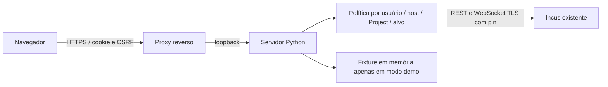

# Arquitetura e decisões R4

## DEC-01 / DEC-03 — proxy local e autorização

O navegador consome uma API de mesma origem. Um serviço Python local acessa endpoints Incus fixos por HTTPS e certificado de cliente. O certificado e a chave não são transmitidos ao navegador. Sessões independentes usam cookie HttpOnly/SameSite Strict, hash scrypt, expiração absoluta e token CSRF por sessão. Mutações e login exigem Origin exata; a API não habilita CORS.

A conta web não determina sua própria função: o administrador configura papéis e escopos no servidor. O serviço verifica host, Project, alvo descartável e confirmação antes de qualquer mutação. O Incus continua responsável pela autorização da identidade TLS. A versão usa uma identidade TLS por host, compartilhada pelas contas web desse host: é uma fronteira de confiança relevante, não uma identidade Incus individual por usuário. Para isolamento forte entre turmas, use certificados restritos e instâncias de serviço separadas. O painel não substitui OpenFGA/OIDC nem oferece provisionamento de identidades.

Essa é uma escolha de implementação, **ainda sem aprovação experimental R4**: os custos CPU/RAM/latência não foram medidos no H3. O caminho direto browser/Incus não foi experimentalmente comparado. Evitou-se depender de APIs de certificados de cliente no JavaScript e manter chaves de administração no frontend.

## DEC-02 — métricas

Host: `/1.0/resources`, somente com `host_metrics: true`. Container: `/instances/{name}/state`. Pool: `/storage-pools/{name}/resources`. A UI mostra fonte, data e valores desconhecidos. CPU de instância é tempo acumulado em segundos, não percentual. Não há taxa de rede derivada nem percentual de CPU host inventado. O painel não soma tamanhos lógicos Btrfs. Não consulta Prometheus `/metrics` em loop.

## DEC-04 / DEC-05 — licença e stack

Código novo sob MIT. Python 3.11+ com biblioteca padrão no servidor e HTML/CSS/JavaScript nativos no navegador. Sem instalação npm/pip, bundle de framework ou módulos nativos a compilar para ARMv7. Node é ferramenta opcional de desenvolvimento. Python já é comum em Debian; o footprint efetivo permanece a medir. Não foi utilizado código Proxmox, Incus ou de outros painéis.

## Componentes

REST é o estado autoritativo. Eventos expõem ao navegador apenas um contador de invalidação, não payloads contendo metadados sensíveis. Cada reconexão incrementa a versão para refazer as leituras, com backoff de 1 a 30 s. O browser consulta notificações a cada 2 s e faz polling completo a cada 15 s. Assinaturas de eventos são isoladas por sessão/host/Project, com uma assinatura ativa por sessão.

Console: `POST exec` interativo, `/bin/sh`, WebSockets de dados e controle no servidor. A ponte navegador/proxy usa chamadas HTTP autenticadas, saída a cada 500 ms e entrada por linha. Buffers limitados a 64 KiB, frames limitados a 1 MiB, um console por sessão/quatro por processo. Ausência de acesso por 30 s, expiração ou logout encerram canais. Não há histórico de comandos persistido; dados do terminal não são logs do aplicativo. O suporte a dimensionamento existe na API do proxy; a UI usa 100×30 inicialmente.

## Limites da infraestrutura

O serviço HTTP padrão Python é destinado aqui a rede privada/laboratório, atrás de proxy HTTPS com limites de conexão e de taxa. Não houve auditoria de implantação pública multiusuário. Não há banco: sessões, auditoria de 200 mutações e fixtures somem ao reiniciar. Tasks concluídas dependem do ciclo de retenção do Incus e da aba atual. Preferências locais contêm apenas seleção de host/Project. Nenhum experimento ou mudança em produção foi executado.

Consultas globais de pools/recursos exigem permissão separada; o inventário de Projects vem dos escopos do painel. Projects/profiles compartilhados podem exigir restrições adicionais na política Incus. Certificados precisam ter SAN compatível com o hostname usado; não se desliga a verificação para contornar certificado incompatível.

Contratos consultados: [REST oficial](https://linuxcontainers.org/incus/docs/main/rest-api/), [exec](https://linuxcontainers.org/incus/docs/main/instance-exec/) e [eventos](https://linuxcontainers.org/incus/docs/main/events/). Essas referências atuais não substituem a conferência do OpenAPI do Incus 6.0.4 alvo; essa conferência é um gate pendente de integração.
